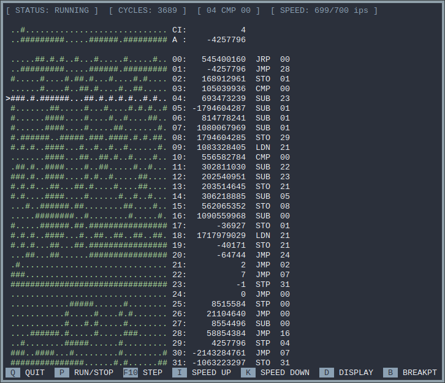
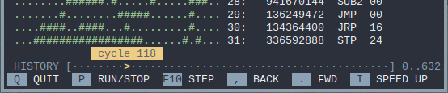
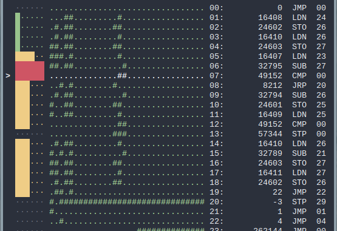
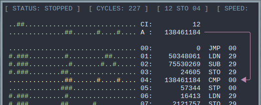
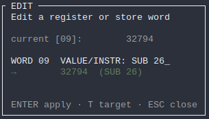
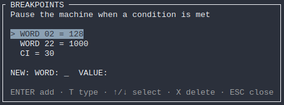

# Small-Scale Experimental Machine (SSEM) simulator

The SSEM, also known as the Manchester Baby was the first electronic stored-program computer.  
As it is very simple, it is a good subject to study the basic principles of computing.  
This program aims at simulating accurately the SSEM while allowing to play with it and tweak it.



# Test it

```sh
cargo run -r samples/ssem/factorct.asm
```

# Features

## Rewind

Use the mouse to navigate in previous states of the machine. Or use the `,` and `.` keys to step back and forth.
The machine can then be modified and restarted from any point.



## Heatmap

Visualise the execution path of the program. The heatmap shows the relative frequency of word execution.



## Flow visualisation

Show where the data moves.



## Live edit

Double click on any word to edit it, either by entering an instruction or by setting a numeric value.



## Breakpoints

Set conditions that will stop the machines if one of them is met.



## Headless mode

Run the machine as fast as possible without any graphical interface and only print the last state of the machine

# Documentation

## Main characteristics

- 32 bits program counter called CI
- 32 bits general purpose register called accumulator or A
- 32 words of 32 bits each random access memory called store
- 5 bits addressing
- 7 instructions including jumps, load, store, substract, compare and stop
- Integer stored least significant bit first

## Instruction set

| Op code | Original notation | Modern notation | Description                                        |
| :------ | :---------------- | :-------------- | :------------------------------------------------- |
| 000     | s,C               | JMP             | Indirect jump                                      |
| 100     | c+s,C             | JRP             | Relative jump                                      |
| 010     | -s,A              | LDN             | Load negative of value in address S to accumulator |
| 110     | a,S               | STO             | Store accumulator in address S                     |
| 001     | a-s, A            | SUB             | Substract value in address S from accumulator      |
| 101     | -                 | -               | Same as SUB                                        |
| 101     | Test              | CMP             | Skip next instruction if accumulator is negative   |
| 111     | Stop              | STP             | Halt the program                                   |

Format of an instruction (example here is STO 26):
```
._.__........__.................

-----        ---
  ^           ^
  |           `--- Operation code
  `--------------- S: address passed to the instruction
```
The other bits are not used.


# Bibliography

David Tarnoff, "Programming the 1948 Manchester Baby (SSEM)" https://www.youtube.com/watch?v=o7ozlF5ujUw

Chris P Burton, "The Manchester University Small-Scale Experimental Machine Programmer's Reference Manual" http://curation.cs.manchester.ac.uk/computer50/www.computer50.org/mark1/prog98/ssemref.html

Computer Conservation Society, "SSEM - Technical Overview" https://computerconservationsociety.org/ssemvolunteers/volunteers/introframe.html

David Sharp, "Manchester Baby Simulator" https://davidsharp.com/baby/

Brian Napper, "The Manchester Small Scale Experimental Machine -- "The Baby""
https://web.archive.org/web/20081013180637/http://www.computer50.org/mark1/new.baby.html#specification

# License

This program is licensed under the MIT license.
